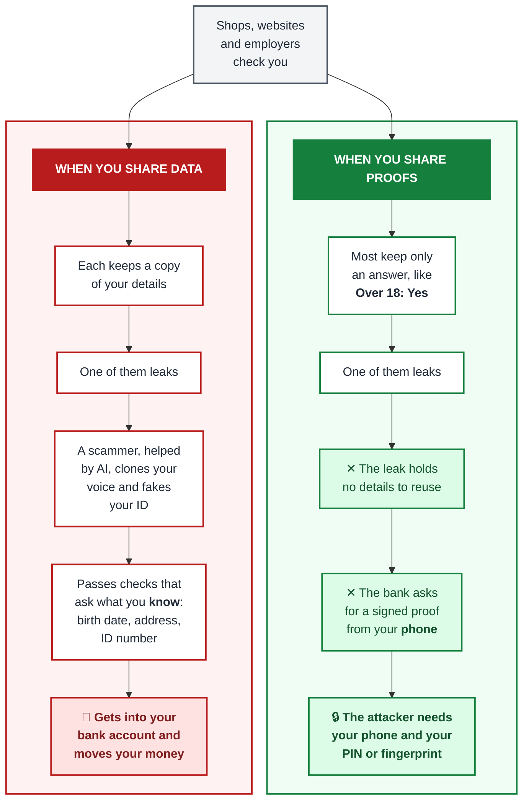
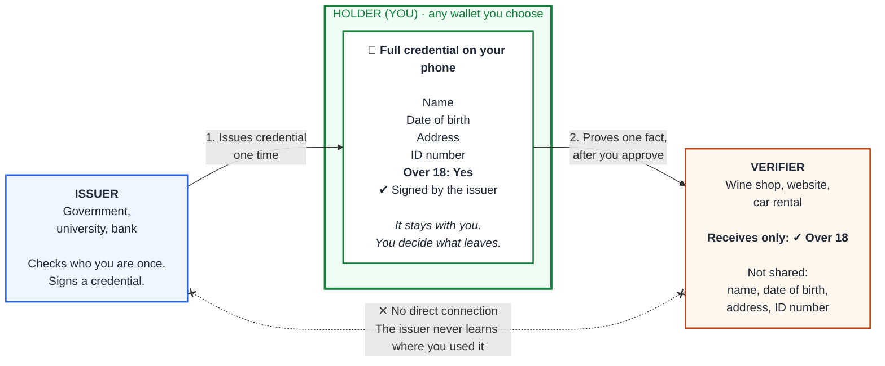
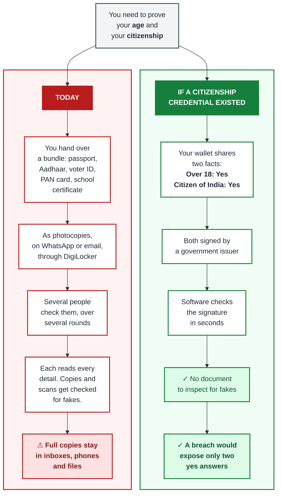

A few years ago, when I joined a new company, HR emailed my personal Gmail account. Around seven people were on copy, from HR, Finance and an outside employee verification agency. The email asked for my Aadhaar card. I was expected to reply all with a copy.

Aadhaar is India's national ID. My card showed my name, photo, date of birth, address, my father's name and my full 12-digit Aadhaar number.

HR and Finance already had my PAN card (India's tax ID), my voter ID and a masked Aadhaar. A masked Aadhaar is the same card with all but the last four digits of the number hidden. I refused to send the full card that way. I also asked HR and Finance why the masked one wasn't enough. Nobody had a clear answer.

The HR executive was confused. She said, "This is how things are done. It's part of the process. Nobody ever refuses."

She then asked me to come to the office with my original documents for verification. She photocopied them and shared the copies with the same people. By the time I found out, it was already done. I was unhappy.

Later, she complained to senior management that I was creating onboarding problems and had an attitude problem.

Eventually I found out who actually needed my full Aadhaar, and why. I'll come back to that.

HR was right about one thing: this is how things are done, almost everywhere. Hotels photocopy your passport. Telecom shops keep a copy of your ID card. Websites ask you to upload a scan of your passport just to prove your age. A wine shop checks your driving licence and sees your name, date of birth, address and licence number. All it needs to know is whether you are over the legal age: 18 in many countries, 21 or more in some.

We have done this so many times that it feels normal. It is a habit, and almost nobody questions it.

The technology to break that habit is ready. A digital wallet on your phone can now prove a single fact, such as "over 18", without showing the document behind it. The harder part is getting both sides of the counter to use it.

---

### My data is mine

Personal data is any detail that points to you. Your name, date of birth, address, phone number, ID numbers, photo, fingerprints and voice all count.

One detail on its own may seem harmless. Put a few together and they describe exactly one person on earth: you.

My personal data belongs to me. Not to the shop. Not to the app. Not to my employer. Not even to my family.

I still share it. The difference is that **I decide** who sees it, how much they see and why.

Today that decision is mostly made for us. A form asks for everything, and we fill in everything. Few of us ask whether the form needs it.

**Every copy you hand over is a copy you can never take back.** You cannot recall it. You cannot check how it is stored. You cannot know who it is shared with next.

---

### Trust is not access

We often confuse trust with access.

I trust the shop enough to buy wine from it. That trust gives the shop no claim on my home address.

A friend I trust still has no right to read my medical records.

I trusted my employer enough to join it. That trust gave around seven inboxes no claim on my full Aadhaar card.

**Trusting someone for one purpose does not give them access to everything about me.** Trust is specific. Access should be specific too.

---

### The question is not the data

Back to my Aadhaar.

Between my PAN card, my voter ID and the masked Aadhaar, HR and Finance had every detail they needed except one: the full Aadhaar number.

That number goes on the form for my Provident Fund (PF), India's retirement savings scheme for salaried employees. One person in Finance filled in that form. He needed the number. Nobody else did.

So the real need was one number, for one form, filled in by one person. The process asked for a copy of the whole card, sent to around seven people, including an outside agency.

In my view, if the PF office had acted as the verifier and checked my Aadhaar with me directly, this whole process would not have been needed.

The same gap shows up everywhere:

*   **Buying alcohol.** The real question is "over the legal age?" The shop sees your full ID.
*   **Age checks online.** The real question is "over 13?" or "over 16?" The website asks for a passport scan or a face scan.
*   **Renting a car.** The real questions are "over 21?" and "allowed to drive?" The company photocopies your whole licence.
*   **Senior discounts.** The real question is "over 60?" The cinema sees your birth date, address and ID number.

Almost nobody asks "why do you need my date of birth?" So the people who collect it rarely have to think about what they actually need to know.

This is the shift in thinking I want people to make. Before you share anything, ask one question:

**What question are you really trying to answer?**

Sometimes the honest answer is "I need your full date of birth." That is fine, and then you share it. My PF form had an honest answer too. At first, nobody in the process could tell me what it was. What matters is that someone asks the question first.

---

### "But the law requires it"

The common pushback is that banks and other regulated companies are legally required to collect these details. That is true. So why does the law ask for them?

Name, date of birth and address are a **paper-era way of identifying people**. No single detail picks you out. Two people can share a name. Two people can share a birthday. So institutions collect several details and combine them until only one person matches.

Know Your Customer (KYC) rules wrote that workaround into law. The law asks for all those details because, at the time, there was no better way to tell two people apart.

**Laws describe the tools of their time.**

There are other reasons too. Regulators want accountability. If a crime happens, someone must be able to find the real person. That is a fair requirement. It still gives no reason for every bank, broker and phone company to keep its own copy of your details.

Imagine a trusted authority, such as a government office, verifies who you are once. It gives you a signed, tamper-proof certificate that says so. A bank can rely on that check instead of rebuilding your identity from scattered details. If a court ever needs to know who you are, the authority that verified you can answer. Accountability stays. The pile of copies goes.

The law is already starting to move. The European Union's updated digital identity law (eIDAS 2.0) requires EU countries to offer their citizens a digital identity wallet. Over the next few years, banks and other regulated services in the EU will have to accept that wallet when a customer chooses to use it.

Even then, a bank doing KYC through the EU wallet still receives the same details. The KYC rules still ask for them.

Somewhere along the way, collecting data became the goal. The reason for collecting it was forgotten. The habit became a form. The form became a process. The process became a rule. Today that rule is quoted as the reason for collecting the data in the first place.

That is where my HR team was. They could only tell me it was part of the process.

**The laws themselves may need to change**, so that they ask for the fact rather than the data. That change needs a change in thinking first. Laws follow what people understand and demand.

---

### Why this matters more in the age of AI

There is a darker reason to care.

Most systems still treat **knowing** your details as proof of **being** you. A bank asks for your date of birth and address. A support line asks for the last four digits of your ID number. Pass the quiz and you are "verified".

Now imagine your details are freely available, because they were copied a hundred times and leaked a few. Anyone can pass that quiz. An AI with a cloned version of your voice can pass it over the phone. A generated photo can pass a careless document check.

Someone who passes your bank's checks as you can get into your account and move your money. The losses can be severe. Malicious people, and AI agents working for them, can repeat this against many people at once.

**When everyone knows my details, my details stop proving anything.**

So the question becomes: how does the real me prove I am the real me? The answer has to be something a clone cannot copy: **something I hold**, rather than something I know.

Here is the same leak played out twice: once when we share our details, and once when we share only proofs.

**When you share data, every step works for the attacker.** Your details sit in many places, so one leak is enough. AI turns those details into a convincing voice or a fake ID. A check that asks what you know cannot tell the attacker apart from you.

**When you share proofs, the chain breaks twice.** A leaked "Over 18: Yes" gives the attacker nothing to reuse. And the bank asks for a signed proof that only your phone can send. A cloned voice cannot produce it. The attacker would need your phone, and the PIN or fingerprint that opens it.

**This only works once banks stop accepting the quiz.** Leaked data never expires. You can change a password. You cannot change your birthday. As long as a bank accepts your date of birth and address as proof of who you are, a wallet on your phone cannot protect you.

To be honest about the limits: no technology stops someone from making a fake video of you from your public photos. What technology can do is give the real you a way to prove you are real, one that a fake cannot reproduce.

---

### The better way already exists

**OpenID for Verifiable Credentials (OID4VC)** is one way to give you that proof.

Don't let the name scare you. The idea is simple, and you already understand it from the physical world.

Think of a digital wallet on your phone. It holds signed digital certificates, called **credentials**, the way your real wallet holds cards. There are three parties:

*   **The issuer** creates a credential. This could be a government office, a university or a bank. It checks who you are once and signs the credential.
*   **You, the holder,** keep the credential in the wallet on your phone. The standard lets the issuer tie it to your device, so a stolen copy cannot be used from another phone.
*   **The verifier** needs to check something. This could be the wine shop, a website or a car rental company.

Here is what happens between the three during the wine shop age check:

**1. The issuer signs once.** A government office checks who you are and puts a signed credential in your wallet. The credential holds everything: your name, date of birth, address and ID number, plus the fact that you are over 18.

**2. You prove one fact.** When the shop asks "are you over 18?", your phone shows you the request first. If a shop asks for your home address to sell you wine, you can see that and say no. Once you approve, your phone answers **"yes"**, with the issuer's signature attached. The rest of the credential stays in the wallet.

**The shop checks the signature on its own.** Any tampering would break it. The shop learns one fact and nothing more.

**Only you can present it.** When the credential is tied to your phone, every proof also needs a fresh signature from a secret key that only your wallet can use. The issuer never sees that key. So even the issuer cannot use your credential in your place.

**The dotted line is a connection that never happens.** The issuer and the verifier never talk to each other about you. The issuer does not learn where you used the credential, so the government does not get a record of every shop you visit.

OID4VC is an open standard, published by the OpenID Foundation. It defines how wallets, issuers and verifiers talk to each other. The European digital identity wallet uses it to receive credentials and to share them online.

Being open is what sets it apart. **You are not tied to any one provider.**

*   **Any issuer** that follows the standard can issue a credential.
*   **Wallets from different providers** can hold it. A government or an independent company can build one.
*   **Any verifier** that follows the standard can check it. It needs no deal with your wallet provider or your issuer.

No single company or platform sits in the middle of every check. A shop can check a credential issued in another country, as long as the shop trusts that issuer. India's DigiLocker, a government app for storing and sharing documents, works the other way: every share goes through that one system.

The same idea is already reaching people. India's new Aadhaar app lets you share only **"Age above 18"**. I tried it. The file it produced revealed that one fact, signed by UIDAI, the government body that issues Aadhaar. Everything else stayed hidden. Masked Aadhaar and DigiLocker share the document itself, with your name, photo and address on it.

OID4VC has its own limits. The standard is new. It may still have flaws that nobody has found. The wallets that use it are newer still. Their bugs are still being found and fixed. A thief who gets your phone and gets past its lock could use your credentials. Nothing in security is perfect. The direction is still right.

OID4VC is only the means. The goal is the change in thinking: **prove the fact, not the data.**

---

### Five documents or one proof

The wine shop is the simple case. Proving your age and your citizenship in India can take far more.

Today you might hand over a bundle: a passport, an Aadhaar card, a voter ID, a PAN card and a school certificate. One document is rarely enough. Several people check them, over several rounds. The documents travel as photocopies, over WhatsApp or email, or through DigiLocker.

The documents differ from country to country. Most of us have been through some version of this. It is how our personal data gets shared.

The people checking carry a burden too. They have to read every detail with care. They also have to spot a forged photocopy or an edited scan. Meanwhile, full copies of your documents pile up in places you will never see.

Now imagine a credential that answers both questions at once: **Over 18: Yes** and **Citizen of India: Yes**, signed by a government issuer. This credential is hypothetical. Here is what it would change:

**The verifier's work shrinks to seconds.** Software checks the issuer's signature. A forged or edited credential fails that check, so nobody has to inspect a document for fakes.

**There is far less to leak.** The verifier receives two facts. A breach of its systems would expose only two yes answers.

**You hand over nothing else.** Your passport number, address and school records stay in your wallet.

Who knows? One day we may not need these documents at all. In India today, your PAN card, voter ID, Aadhaar card and driving licence each repeat the same details: your name, date of birth, photo and often your father's name.

Your identity could be issued once instead, as one core identity credential. The European Union calls this Person Identification Data. Your PAN, the tax ID, would then be a small credential that carries just your PAN number. Your voter ID would carry just your voter ID number and where you are registered to vote. Each would be linked to that one identity credential. A check could then ask for exactly the pieces it needs.

That will only happen once we accept the problem, understand it, and think about how to solve it. A citizenship credential, or a single core identity, is the kind of idea that thinking produces.

---

### Three groups have to change

The standards are published. Governments and phone makers are rolling out wallets.

A wallet that can share less does not help if the other side still asks for everything. When one document shows too little, they ask for another. Very few verifiers can even accept a proof today. Three groups have to change how they think.

**People** need to understand when to share and what to share. A request for your date of birth is not automatically a fair one. Ask what question it answers.

**Verifiers** need to be built for proofs. Every shop, website, bank, employer and app that checks people must be able to accept a signed answer instead of a photocopy. More importantly, they must stop and ask what they really need to know. Today they ask for everything because it is easy and customers rarely object. An extra field on a form costs them almost nothing. The risk of storing your data falls mostly on you.

**Lawmakers** need to revisit rules written for paper. A rule that demands a date of birth when the real need is "over 18" keeps the old habit alive, whatever technology exists.

Each group waits for the others. Businesses say the law makes them collect. Lawmakers hear no demand for change. People do not object, because they never knew they could. The few who do object can end up like me, with a complaint about their attitude.

The cycle breaks when enough people ask the question. When customers ask "why do you need this?", businesses have to find an answer. When enough of them cannot find one, they start asking for less. When enough businesses ask for less, the rules can follow.

**The protocols already work. Adoption now depends on people understanding what their data is worth, and on verifiers understanding what they actually need.**

---

### What you can do

You don't need to understand cryptography to start.

*   **Ask "why do you need this?"** before you share a detail. Ask what question they are actually trying to answer.
*   **Prefer services that ask for less.** Reward the ones that only check what they need.
*   **Treat your personal details like your house keys.** You wouldn't hand them to every shop you walk into.
*   **Use digital IDs where they already exist**, and check what each request asks for before you approve it.
*   **If you build or run a system that checks people,** ask what question each field answers. Remove the fields that answer none. If a field exists only to be passed on to another office, ask whether that office could check it with the person directly.

---

### The slowest part is how we think

Wallets that prove a single fact are already on phones. The shops, banks, employers and laws on the other side have not caught up. The slowest part is the habit on both sides: collecting everything because we always have, and handing over everything because someone asked.

That HR executive told me nobody ever refuses. Most people never even ask.

The question is not the data. The next time someone asks for your ID card or your date of birth, ask them what their question really is.
